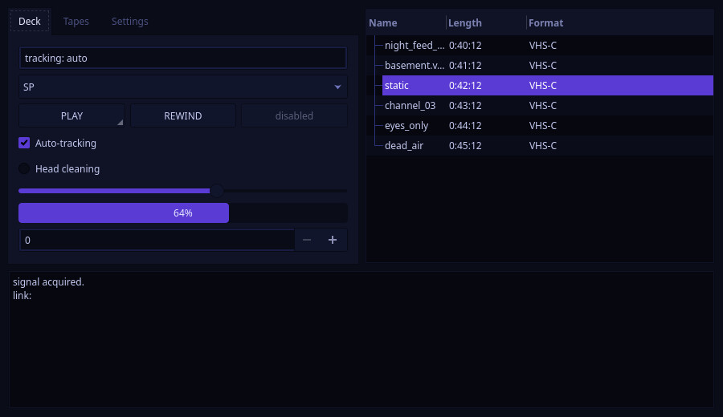
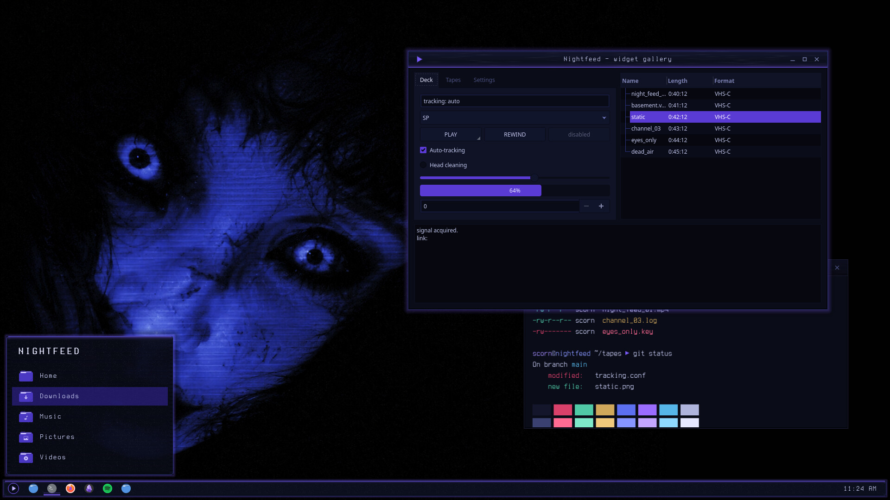

# Nightfeed — Kvantum Theme

Kvantum widget style in cobalt-black with violet accents: recessed text fields, violet sliders, checks and progress bars, dim selections.



Nightfeed is a night-vision VHS look for KDE Plasma 6, built around a cobalt-lit face on near-black: cobalt-black surfaces, faint scanlines and tape grain, and a slight violet glow on whatever has focus.

## Features

- Built on KvArcDark's engine map. The greys are remapped by luminance onto a cobalt-black ramp, and Arc's blue becomes violet.
- Text fields sit recessed, darker than the buttons.
- Sliders, checks, progress bars and focus rings are violet. Selections are a dimmer violet.
- Blurred popups. Matches the Nightfeed colour scheme.



## Requirements

Kvantum (`kvantum` package), with the widget style set to kvantum.

## Install

```bash
git clone https://github.com/numbpill3d/nightfeed-kvantum
cd nightfeed-kvantum && ./install.sh
```

Or from the KDE Store: Extract to `~/.config/Kvantum/` and select **Nightfeed** in Kvantum Manager, then set the Application Style to kvantum.

## The rest of the suite

| piece | repo |
|---|---|
| SDDM login | [nightfeed-sddm](https://github.com/numbpill3d/nightfeed-sddm) |
| Plymouth boot splash | [nightfeed-plymouth](https://github.com/numbpill3d/nightfeed-plymouth) |
| Global theme + splash screen | [nightfeed-global](https://github.com/numbpill3d/nightfeed-global) |
| Plasma style (panel, popups) | [nightfeed-plasma](https://github.com/numbpill3d/nightfeed-plasma) |
| Aurorae window decoration | [nightfeed-aurorae](https://github.com/numbpill3d/nightfeed-aurorae) |
| Colour scheme | [nightfeed-colors](https://github.com/numbpill3d/nightfeed-colors) |
| Icon theme | [nightfeed-icons](https://github.com/numbpill3d/nightfeed-icons) |
| Konsole + kitty colours | [nightfeed-konsole](https://github.com/numbpill3d/nightfeed-konsole) |

Everything at once, with the generators: [nightfeed](https://github.com/numbpill3d/nightfeed).

## Tags

`nightfeed` `kde` `plasma6` `dark` `vhs` `scanlines` `cobalt` `violet` `purple` `retro` `analog-horror` `glow` `kvantum` `qt-style` `widget-style` `qt6` `qt5`

## Credits and licence

By splicer scorn (voidrane). GPL-3.0-or-later.
Engine map adapted from KvArcDark by Tsu Jan (Kvantum, GPL-3.0).
